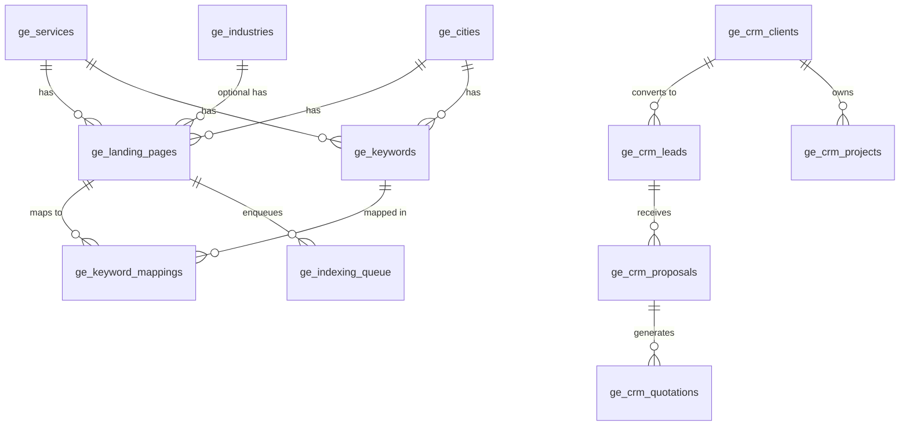
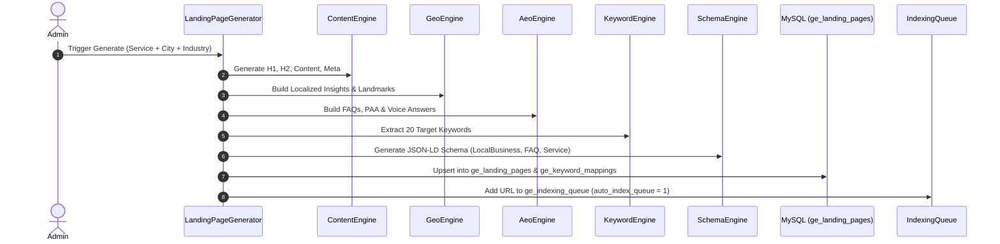
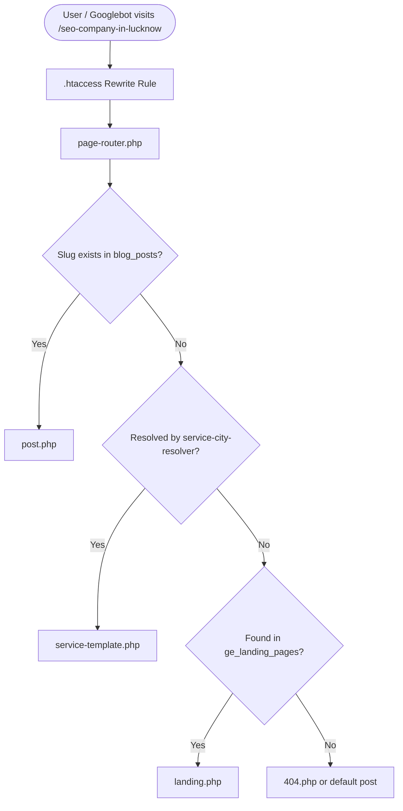

# Nectra Digital — Complete System Architecture, Database Schema & Services Guide

> **Document Version:** 2.0  
> **Platform:** Nectra Digital Enterprise Growth Engine  
> **Architecture:** PHP (Modular OOP + Procedural Core) + MySQL / MariaDB (InnoDB) + Apache URL Rewriting + IndexNow & AI Engine  
> **File Created:** October 2026

---

## 1. System Overview (प्रणाली का परिचय)

**Nectra Digital Growth Platform v2** ek enterprise-grade programmatic SEO, digital marketing services, aur dynamic lead capture/CRM engine hai. Ye platform scale par **Service × City × Industry** matrix ke basis par thousands of landing pages dynamically generate, serve, aur auto-index karta hai.

### Key Pillars:
1. **Triple-Matrix Programmatic SEO:** `Service × City × Industry` ke basis par unique content, meta tags, FAQs, aur schema generate karta hai.
2. **Growth Engines:** Dedicated modular engines (Content, Geo, AEO, Schema, Indexing, Keywords, Internal Links, Sitemap).
3. **Smart Routing (`page-router.php`):** Clean SEO-friendly URLs ko resolve karta hai bina server overhead ke.
4. **Instant Indexing:** Search engine APIs (IndexNow for Bing/Yandex, Google Indexing Queue) ke through pages publish hote hi indexing queue me jate hain.
5. **Integrated CRM & Lead Funnel:** Contact forms aur AI chatbot ke through direct leads capture hoti hain jo CRM me track aur convert hoti hain.

---

## 2. Complete Database Schema (डेटाबेस स्कीमा)

Database tables `ge_` (Growth Engine) prefix ke saath organized hain. Ye v1 aur v2 architecture me categorized hain:



---

### 2.1 Core Entity Tables (मास्टर टेबल्स)

#### Table: `ge_services`
Services catalog jisme service details, templates, aur schema configurations store hoti hain.
```sql
CREATE TABLE ge_services (
    id INT UNSIGNED AUTO_INCREMENT PRIMARY KEY,
    name VARCHAR(255) NOT NULL,
    slug VARCHAR(255) NOT NULL UNIQUE,
    url_prefix VARCHAR(255) NOT NULL UNIQUE COMMENT 'URL segment e.g. seo, software-development',
    meta_title_template VARCHAR(500) DEFAULT NULL,
    meta_description_template TEXT DEFAULT NULL,
    h1_template VARCHAR(500) DEFAULT NULL,
    h2_template VARCHAR(500) DEFAULT NULL,
    content_template LONGTEXT DEFAULT NULL,
    service_image VARCHAR(500) DEFAULT NULL,
    faq_template JSON DEFAULT NULL,
    keywords_template TEXT DEFAULT NULL,
    schema_type VARCHAR(50) DEFAULT 'Service',
    sort_order INT DEFAULT 0,
    status ENUM('active','inactive') NOT NULL DEFAULT 'active',
    created_at TIMESTAMP DEFAULT CURRENT_TIMESTAMP,
    updated_at TIMESTAMP NULL ON UPDATE CURRENT_TIMESTAMP
);
```

#### Table: `ge_cities`
Geographical targets (Tier-1, Tier-2, Tier-3 cities in India and global locations).
```sql
CREATE TABLE ge_cities (
    id INT UNSIGNED AUTO_INCREMENT PRIMARY KEY,
    name VARCHAR(255) NOT NULL,
    slug VARCHAR(255) NOT NULL UNIQUE,
    state VARCHAR(255) DEFAULT NULL,
    country VARCHAR(100) NOT NULL DEFAULT 'India',
    population INT UNSIGNED DEFAULT 0,
    latitude DECIMAL(10,8) DEFAULT NULL,
    longitude DECIMAL(11,8) DEFAULT NULL,
    city_description TEXT DEFAULT NULL,
    status ENUM('active','inactive') NOT NULL DEFAULT 'active',
    created_at TIMESTAMP DEFAULT CURRENT_TIMESTAMP,
    updated_at TIMESTAMP NULL ON UPDATE CURRENT_TIMESTAMP
);
```

#### Table: `ge_industries` (v2 Extension)
Industry verticals (e.g., Healthcare, Real Estate, E-commerce, EdTech, Finance).
```sql
CREATE TABLE ge_industries (
    id INT UNSIGNED AUTO_INCREMENT PRIMARY KEY,
    name VARCHAR(255) NOT NULL,
    slug VARCHAR(255) NOT NULL UNIQUE,
    description TEXT DEFAULT NULL,
    icon VARCHAR(100) DEFAULT 'fa-industry',
    meta_title_template VARCHAR(500) DEFAULT NULL,
    meta_description_template TEXT DEFAULT NULL,
    status ENUM('active','inactive') NOT NULL DEFAULT 'active',
    created_at TIMESTAMP DEFAULT CURRENT_TIMESTAMP,
    updated_at TIMESTAMP NULL ON UPDATE CURRENT_TIMESTAMP
);
```

#### Table: `ge_keywords`
Keyword repository targeting specific services, cities, and search intents.
```sql
CREATE TABLE ge_keywords (
    id INT UNSIGNED AUTO_INCREMENT PRIMARY KEY,
    keyword VARCHAR(500) NOT NULL,
    keyword_type ENUM('primary','secondary','lsi','commercial','transactional','informational','local','long_tail','semantic') NOT NULL DEFAULT 'primary',
    service_id INT UNSIGNED DEFAULT NULL,
    city_id INT UNSIGNED DEFAULT NULL,
    industry_id INT UNSIGNED NOT NULL DEFAULT 0,
    landing_page_id INT UNSIGNED DEFAULT NULL,
    is_auto_generated TINYINT(1) NOT NULL DEFAULT 0,
    status ENUM('active','inactive') NOT NULL DEFAULT 'active',
    created_at TIMESTAMP DEFAULT CURRENT_TIMESTAMP
);
```

---

### 2.2 Programmatic Landing Pages & Generation

#### Table: `ge_landing_pages`
Generate hone wale pages ka complete snapshot (Content, Schema, Meta, FAQs, Voice Data).
```sql
CREATE TABLE ge_landing_pages (
    id INT UNSIGNED AUTO_INCREMENT PRIMARY KEY,
    service_id INT UNSIGNED NOT NULL,
    city_id INT UNSIGNED NOT NULL,
    industry_id INT UNSIGNED NOT NULL DEFAULT 0,
    page_type ENUM('service_city','service_city_industry') NOT NULL DEFAULT 'service_city',
    slug VARCHAR(500) NOT NULL UNIQUE,
    url_path VARCHAR(500) NOT NULL,
    meta_title VARCHAR(255) DEFAULT NULL,
    meta_description TEXT DEFAULT NULL,
    h1 VARCHAR(500) DEFAULT NULL,
    h2 VARCHAR(500) DEFAULT NULL,
    h3 VARCHAR(500) DEFAULT NULL,
    content LONGTEXT DEFAULT NULL,
    quick_answer TEXT DEFAULT NULL,
    key_takeaways TEXT DEFAULT NULL,
    summary TEXT DEFAULT NULL,
    expert_insight TEXT DEFAULT NULL,
    faq_json JSON DEFAULT NULL,
    schema_json JSON DEFAULT NULL,
    keywords_json JSON DEFAULT NULL,
    paa_json JSON DEFAULT NULL,
    voice_answer TEXT DEFAULT NULL,
    internal_links_json JSON DEFAULT NULL,
    cta_json JSON DEFAULT NULL,
    content_hash CHAR(64) DEFAULT NULL,
    is_indexed TINYINT(1) NOT NULL DEFAULT 0,
    index_status ENUM('pending','submitted','indexed','excluded','failed') NOT NULL DEFAULT 'pending',
    index_submitted_at DATETIME DEFAULT NULL,
    index_verified_at DATETIME DEFAULT NULL,
    status ENUM('published','draft','archived') NOT NULL DEFAULT 'published',
    generated_at TIMESTAMP DEFAULT CURRENT_TIMESTAMP,
    updated_at TIMESTAMP NULL ON UPDATE CURRENT_TIMESTAMP,
    UNIQUE KEY uk_ge_lp_combo (service_id, city_id, industry_id)
);
```

#### Table: `ge_keyword_mappings`
Page-level keyword association with rankings and hierarchy.
```sql
CREATE TABLE ge_keyword_mappings (
    id INT UNSIGNED AUTO_INCREMENT PRIMARY KEY,
    landing_page_id INT UNSIGNED NOT NULL,
    keyword_id INT UNSIGNED NOT NULL,
    is_primary TINYINT(1) NOT NULL DEFAULT 0,
    position INT NOT NULL DEFAULT 0,
    UNIQUE KEY uk_ge_km_lp_kw (landing_page_id, keyword_id)
);
```

#### Table: `ge_generation_jobs` & `ge_generation_queue`
Async batch processing and tracking:
```sql
CREATE TABLE ge_generation_jobs (
    id INT UNSIGNED AUTO_INCREMENT PRIMARY KEY,
    job_type ENUM('single','bulk','service_all_cities','city_all_services','full_matrix','regenerate') NOT NULL,
    service_id INT UNSIGNED DEFAULT NULL,
    city_id INT UNSIGNED DEFAULT NULL,
    total_pages INT UNSIGNED NOT NULL DEFAULT 0,
    processed INT UNSIGNED NOT NULL DEFAULT 0,
    failed INT UNSIGNED NOT NULL DEFAULT 0,
    status ENUM('queued','running','completed','failed','cancelled') NOT NULL DEFAULT 'queued',
    error_log TEXT DEFAULT NULL,
    started_at DATETIME DEFAULT NULL,
    completed_at DATETIME DEFAULT NULL,
    created_at TIMESTAMP DEFAULT CURRENT_TIMESTAMP
);

CREATE TABLE ge_generation_queue (
    id INT UNSIGNED AUTO_INCREMENT PRIMARY KEY,
    job_id INT UNSIGNED DEFAULT NULL,
    service_id INT UNSIGNED NOT NULL,
    city_id INT UNSIGNED NOT NULL,
    industry_id INT UNSIGNED NOT NULL DEFAULT 0,
    status ENUM('pending','processing','done','failed','skipped') NOT NULL DEFAULT 'pending',
    result_slug VARCHAR(500) DEFAULT NULL,
    error_message TEXT DEFAULT NULL,
    created_at TIMESTAMP DEFAULT CURRENT_TIMESTAMP,
    processed_at DATETIME DEFAULT NULL
);
```

---

### 2.3 Search Engine Indexing

#### Table: `ge_indexing_queue`
IndexNow aur Google API submission queue:
```sql
CREATE TABLE ge_indexing_queue (
    id INT UNSIGNED AUTO_INCREMENT PRIMARY KEY,
    landing_page_id INT UNSIGNED DEFAULT NULL,
    url VARCHAR(500) NOT NULL,
    action_type ENUM('submit','check','remove') NOT NULL DEFAULT 'submit',
    status ENUM('pending','processing','completed','failed') NOT NULL DEFAULT 'pending',
    response TEXT DEFAULT NULL,
    created_at TIMESTAMP DEFAULT CURRENT_TIMESTAMP,
    processed_at DATETIME DEFAULT NULL
);
```

---

### 2.4 EEAT, Authority, Knowledge Base & Tools

- **`ge_authors`**: Author authority (Founder credentials, bio, LinkedIn, expertise JSON).
- **`ge_reviews`**: Verified client reviews and testimonials.
- **`ge_case_studies`**: Client case studies with results metrics and schemas.
- **`ge_pillar_pages`**: Top-level pillar content connecting silos.
- **`ge_knowledge_base`**: Direct question-and-answer library optimized for AEO/SGE.
- **`ge_tools`**: Inbuilt free marketing tools (SEO Audit, Keyword tool, ROI calculator, Meta tag generator).
- **`ge_competitor_analyses`**: Competitor analysis storage (H1s, schemas, keywords, gaps).
- **`ge_analytics_events`**: Custom analytics event tracking.
- **`ge_settings`**: Global configuration dictionary (founder details, url patterns, API settings).

---

### 2.5 Integrated CRM (Lead & Client Management)

- **`ge_crm_clients`**: Client accounts, contact persons, and companies.
- **`ge_crm_leads`**: Inbound leads from website forms, service landing pages, and AI Chatbot.
- **`ge_crm_projects`**: Track project status, budget, start/end dates.
- **`ge_crm_proposals`**: Proposals with pricing and scope.
- **`ge_crm_quotations`**: Invoicing and quotations with itemized line items and taxes.

---

## 3. Services Architecture (सर्विसेज आर्किटेक्चर)

Nectra Digital provides 13 core service verticals across 4 major business silos:

| Silo | Service Slug | URL Prefix / Route | Primary Target Audience |
|---|---|---|---|
| **SEO & Search** | `seo-services` | `seo-services` | National & Global Organic Traffic |
| **SEO & Search** | `local-seo-services` | `local-seo-services` | Local Businesses, Map Packs, GMB |
| **SEO & Search** | `technical-seo-services` | `technical-seo-services` | Web Core Vitals, Crawlability, Schemas |
| **SEO & Search** | `enterprise-seo-services` | `enterprise-seo-services` | Large-scale multi-domain enterprises |
| **Paid Media & Ads** | `digital-marketing-services` | `digital-marketing-services` | Integrated omnichannel growth |
| **Paid Media & Ads** | `ppc-management` | `ppc-management` | ROI-focused paid search & displays |
| **Paid Media & Ads** | `google-ads-management` | `google-ads-management` | Search, Display, YouTube, Shopping Ads |
| **Paid Media & Ads** | `meta-ads-services` | `meta-ads-services` | Facebook, Instagram & WhatsApp Ads |
| **Paid Media & Ads** | `performance-marketing-services` | `performance-marketing-services` | Conversion-driven media buying & CRO |
| **Paid Media & Ads** | `social-media-marketing-services` | `social-media-marketing-services` | Organic & paid social brand presence |
| **AI Automation** | `ai-automation-services` | `ai-automation-services` | Workflow automation & business AI |
| **AI Automation** | `ai-chatbot-development` | `ai-chatbot-development` | Custom GPT/LLM website bots |
| **AI Automation** | `whatsapp-ai-bot-development` | `whatsapp-ai-bot-development` | WhatsApp Business API automation |
| **Dev & Engineering** | `web-development-services` | `web-development-services` | Next.js, React, WordPress, Laravel |
| **Dev & Engineering** | `software-development-services` | `software-development-services` | Custom SaaS & Enterprise Software |
| **Dev & Engineering** | `mobile-app-development` | `mobile-app-development` | Flutter, React Native, iOS & Android |
| **Dev & Engineering** | `ecommerce-development` | `ecommerce-development` | Shopify, WooCommerce, Custom Stores |

---

## 4. Growth Engines (`includes/growth/engines/`)

Platform me modular architecture follow hota hai jahan har responsibility ek Engine class ke paas hoti hai:

```
includes/growth/
├── bootstrap.php               # System initialization, DB connectivity, helpers loader
├── LandingPageGenerator.php    # Matrix generation orchestrator (Single, Bulk, Full Matrix)
├── helpers.php                 # Utility functions (slug builders, hashing, JSON safe encoding)
├── engines/
│   ├── AeoEngine.php           # Answer Engine Optimization (Voice, PAA, FAQs for AI Search)
│   ├── CatalogSyncEngine.php   # Bidirectional sync between php catalog and MySQL DB
│   ├── CompetitorEngine.php    # Web scraper and competitor analysis
│   ├── ContentEngine.php       # Dynamic text synthesis and spin variation generator
│   ├── DiscoveryEngine.php     # Google Discover & RSS syndication feeds
│   ├── GeoEngine.php           # City demographics, landmarks, localized content builder
│   ├── IndexingEngine.php      # IndexNow (Bing/Yandex) & Google Indexing API submitter
│   ├── IntentKeywordEngine.php # Commercial, transactional & LSI keyword classification
│   ├── InternalLinkEngine.php  # Semantic silo linking (city to city, service to service)
│   ├── KeywordEngine.php       # Keyword generation and mapping per page
│   ├── SchemaEngine.php        # JSON-LD Schema builder (LocalBusiness, Service, FAQ, Org)
│   ├── SeoEngine.php           # Title tags, meta descriptions, canonical resolver
│   ├── SeoRefreshEngine.php    # Content freshness updater to prevent stale rankings
│   └── SitemapEngine.php       # Dynamic multi-sitemap generator
└── models/
    ├── Service.php, City.php, Industry.php, LandingPage.php, Keyword.php, etc.
```

---

## 5. End-to-End Workflow: Ye Kaise Kaam Karta Hai? (कार्यप्रणाली)

### Step 1: Database Migration & Catalog Seeding
1. Jab application initialize hoti hai, `database/migrate.php` execute hota hai.
2. Ye `schema.sql` (v1) aur `schema-v2.sql` (v2) run karta hai.
3. `CatalogSyncEngine::syncAll()` automatically `includes/seo-data.php` se default services aur cities ko database tables `ge_services` aur `ge_cities` me upsert kar deta hai.

---

### Step 2: Programmatic Page Generation Pipeline

Admin jab `/admin/growth/generate.php` ya CLI script se page generation trigger karta hai:



1. **Content Synthesis (`ContentEngine`):** Service ke `content_template` aur City data ko lekar localized variations generate karta hai.
2. **Geo Localization (`GeoEngine`):** City ka state, region, economic hubs, aur local business context add karta hai taaki content thin ya duplicate na lage.
3. **AEO & Voice Search Optimization (`AeoEngine`):** Quick answers (40-60 words format for AI search summaries), People Also Ask (PAA) questions, aur conversational voice answers generate karta hai.
4. **Rich JSON-LD Schema (`SchemaEngine`):** Google Search Console compliant multi-type schema inject karta hai:
   - `Service` Schema
   - `LocalBusiness` / `ProfessionalService` Schema with geo-coordinates
   - `FAQPage` Schema
   - `BreadcrumbList` Schema
   - `Organization` & `Person` (EEAT Founder profile) Schema
5. **Storage & Queue:** Page payload database me save hota hai aur indexing queue me URL push ho jati hai.

---

### Step 3: Unified Request Lifecycle & URL Routing (`page-router.php`)

User ya search crawler jab koi URL visit karta hai, request ka flow nimn prakar hota hai:



1. **Clean URL Rewrite (`.htaccess`):**
   ```apache
   RewriteCond %{REQUEST_FILENAME} !-f
   RewriteCond %{REQUEST_FILENAME} !-d
   RewriteRule ^([a-zA-Z0-9-]+)$ page-router.php?slug=$1 [L,QSA]
   ```
2. **Fast Path Blog Check:** Sabse pehle lightweight query chalti hai. Agar slug blog post hai, to Growth Engine load kiye bina direct `post.php` serve hota hai (faster crawler response).
3. **Service × City Dynamic Resolver (`service-city-resolver.php`):** Agar dynamic URL pattern match hota hai (e.g., `seo-company-in-lucknow`), to pre-configured dynamic matrix se high-performance template `service-template.php` render hota hai.
4. **Database Landing Page Fallback:** Agar page database me stored static programmatic page hai, to `landing.php` render hota hai.

---

### Step 4: Automated Search Engine Indexing (Cron Workflow)

Background cron jobs server par schedule rehte hain:

- **`cron/process-indexing.php`**:
  - `ge_indexing_queue` me pending URLs pick karta hai.
  - IndexNow protocol ke through Bing, Yandex, Naver, Seznam ko instantly push karta hai.
  - Status ko `completed` mark karta hai aur response log save karta hai.
- **`cron/process-queue.php`**:
  - `ge_generation_queue` se pending batch jobs pick karke 50-50 ke batches me pages generate karta hai, jisse server memory overload nahi hoti.
- **`cron/publish-discovery.php`**:
  - RSS feeds (`rss.php`, `atom.php`) aur Google Discover feed (`discover-feed.php`) ko update karta hai.

---

### Step 5: Inbound Leads & CRM Workflow

1. **Lead Sources:**
   - Website header contact forms (`contact.php`)
   - Dedicated landing page CTAs & quick inquiry forms
   - AI Chatbot widget (`api/chatbot.php`, `api/chat-lead.php`)
2. **Processing:**
   - Inbound lead `ge_crm_leads` table me `status = 'new'` ke sath insert hoti hai.
   - Lead ka source (`website`, `chatbot`, `landing_page`), city, service interest record hota hai.
3. **Admin Actions (`/admin/growth/leads.php`):**
   - Admin leads ko status change kar sakta hai (`contacted` -> `qualified` -> `proposal` -> `won`).
   - Lead se direct Client account (`ge_crm_clients`) banaya ja sakta hai.
   - Project estimate (`ge_crm_projects`), Proposal (`ge_crm_proposals`), aur GST Quotation (`ge_crm_quotations`) generate kiye ja sakte hain.

---

## 6. Admin Panel Navigation Guide

Admin dashboard `/admin/` par authenticated users ke liye accessible hai:

| Admin Module | File Path | Description |
|---|---|---|
| **Growth Overview** | `/admin/growth/index.php` | Matrix stats, total generated pages, indexing health |
| **Services Management** | `/admin/growth/services.php` | Add/Edit services, templates, schemas, prefixes |
| **Cities Management** | `/admin/growth/cities.php` | Manage target cities, states, populations |
| **Industries Management** | `/admin/growth/industries.php` | Manage business verticals for v2 triple matrix |
| **Matrix Generator** | `/admin/growth/generate.php` | Single, bulk, or full matrix generation runner |
| **Landing Pages Directory**| `/admin/growth/landing-pages.php` | Search, edit, publish/draft generated landing pages |
| **Keywords Hub** | `/admin/growth/keywords.php` | Manage intent keywords, LSI, and page associations |
| **Indexing Management** | `/admin/growth/indexing.php` | Real-time IndexNow dispatch & queue logs |
| **Leads & CRM** | `/admin/growth/leads.php` | Inbound leads tracking, follow-ups, and proposals |
| **EEAT Authors** | `/admin/growth/authors.php` | Manage author credibility, founder bios, schema |
| **Knowledge Base (AEO)** | `/admin/growth/knowledge-base.php` | Direct Q&A management for AI engine optimization |
| **Tools Directory** | `/admin/growth/tools.php` | Manage public SEO & ROI tools |
| **Competitor Intel** | `/admin/growth/competitor.php` | Scrape and analyze competitor keywords & schemas |
| **Global Settings** | `/admin/growth/settings.php` | Configure URL patterns, batch sizes, API credentials |

---

## 7. Key Architecture Highlights (तकनीकी विशेषताएं)

1. **Zero Framework Bloat:** Pure, optimized PHP code without heavy framework overhead ensures sub-100ms TTFB (Time to First Byte), which is crucial for SEO crawlers.
2. **Schema Completeness:** Fully automated JSON-LD schemas matching latest Google Search Central guidelines (EEAT compliance).
3. **Content Duplication Guard:** Har page ke content ka 64-character SHA-256 hash `content_hash` column me store hota hai. Duplicate content hone par alert aur regeneration trigger hota hai.
4. **Resilient Failovers:** Agar database Growth Engine temporarily offline ya upgrading ho, to static fallback templates site ko live rakhte hain (Zero Downtime).

---

*This document serves as the single source of truth for Nectra Digital's technical schema, service layers, and programmatic growth engines.*
